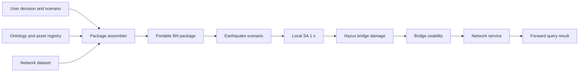

# Forward Bayesian-network pilot

This pilot assembles a reviewable Bayesian-network package from a transport
network, Hazus 6.1 bridge fragility curves, an earthquake representation, a
damage-to-functionality rule, and a connectivity decision. It deliberately
supports forward inference only.



## Run the stakeholder pilot

From the repository root:

```powershell
python -m src.forward_pilot build
python -m src.forward_pilot serve
```

For a stakeholder demonstration, run the launcher and use `Ctrl+C` to stop it:

```powershell
.\scripts\start-forward-bn-pilot.ps1
```

Open `http://127.0.0.1:8765`. The browser UI lets a user choose the network,
set an earthquake, select origins and destinations, run Monte Carlo forward
inference, and inspect service probabilities and bridge failure marginals.
It does not require an internet connection or a JavaScript build step.

### Asking in words (optional)

The pilot can take a question in plain language instead of form controls. The
panel is off unless the server process holds a credential, and the rest of the
pilot is unaffected when it is off — either an OAuth profile from `ant auth
login` (which sets no environment variable, so `chat.available()` looks on disk
for it) or a key:

```powershell
ant auth login                          # or: $env:ANTHROPIC_API_KEY = "sk-ant-..."
python -m src.forward_pilot serve
```

The division of labour is the point. **Claude chooses the query; the engine
computes the answer.** A question becomes a tool call carrying scenario
parameters, `run_forward_query` runs exactly as it does for the controls, and
the reply reports the numbers that came back. Claude is never asked to estimate
a probability, because it would produce a plausible one and no downstream check
would catch it.

Two consequences worth knowing:

- **The forward-only boundary is unaffected.** It lives in `_validate_query`,
  not in the prompt, so no phrasing reaches a diagnostic answer. Asking "which
  bridge is most critical given the outage?" produces a refusal from the engine,
  which Claude then explains.
- **Every answer shows the query that produced it, before the answer.** The
  query is written out as a probability statement in the model's variables
  (`P(S::o = 1 | Mw = 7, epicentre = (1, 10))`, `P(X::e = 0 | …)`,
  `E[PopFraction | …]`) and sent to the page before the engine is called; the
  computed values follow, then the prose. The statement is built from the query
  alone, so it cannot be fitted to the result. The page redraws from that same
  run - so the map, the table and the prose are one result, and the translation
  from question to parameters can be checked rather than trusted.

Credentials stay server-side; the browser only talks to the local pilot. A
question is a tool round-trip, so it spends two or three Anthropic API calls on
`claude-opus-5` — on the order of a cent or two. API usage bills to a Console
account, which a Claude subscription does not cover. The form controls reach
every query the panel can, without a credential.

A query can also be run without the UI:

```powershell
python -m src.forward_pilot query `
  experiments/forward-bn-pilot/packages/ema-highway `
  experiments/forward-bn-pilot/packages/ema-highway/example_query.json `
  --output experiments/forward-bn-pilot/ema-result.json
```

## Delivered package

Each folder under `experiments/forward-bn-pilot/packages/` contains:

| File | Purpose |
|---|---|
| `manifest.json` | source paths and SHA-256 hashes, counts, scope and assumptions |
| `network.json` | portable network snapshot and default decision context |
| `bn_spec.json` | BN factor templates, supported queries and extension points |
| `query_scope.json` | machine-readable forward-only boundary |
| `example_query.json` | reproducible request |
| `example_result.json` | seeded forward-inference result |

The package uses parametric factors rather than materialising a conditional
probability table over every network state. For EMA, binary bridge usability
alone has `2^129` possible joint states. Conditional forward simulation keeps
the model inspectable while making the pilot responsive.

## Case definitions

### Eastern Massachusetts

- The service event is that an origin can reach **either n22 or n66**.
- Edges are undirected. Every edge is represented by one highway bridge.
- Existing `fragility_type` values (HWB2, HWB4 or HWB11) select the Hazus 6.1
  base curve. No geometric data are available for Hazus bridge modifiers.
- The default earthquake reproduces the dataset's Campbell (2003) T=1 s
  script for Mw 8.0 at schematic coordinate (1, 10).
- The source script labels its epistemic sigma of 0.3 as a placeholder. This
  is retained and surfaced in every result; the scenario is illustrative.

### Hebei

- The default service event is directed connectivity from n1 (Chengde) to n22
  (Handan), matching the source/sink roles in the dataset.
- Its digitised coordinates are unitless, so they cannot support a spatial
  earthquake attenuation calculation.
- For the earthquake pilot, every arc is explicitly assumed to be one HWB11
  bridge and a user supplies uniform SA(1 s). This is a demonstration mapping,
  not an assertion about the real bridges.
- The source dataset's three-state benchmark capacity probabilities remain in
  the source repository but are not earthquake fragilities and are not used by
  this earthquake query.

## The Bayesian network

The network is assembled in [tbnpy](https://github.com/jieunbyun/tbnpy), in
`src/forward_pilot/tbn/` — one module per node class, following tbnpy's own
convention:

```
SA1::<edge>   root, one per bridge      ground motion in g, lognormal
    |
X::<edge>     one per bridge            usable / unusable, Hazus Extensive
    |
S             one node, one child per origin, deterministic reachability
    |
PopFraction   the decision metric       (omitted where there are no weights)
```

EMA is 331 variables across 260 nodes. The scenario is not a variable: the
analyst sets it, so it parameterises the `SA1` roots.

**Ground-motion and fragility dispersions sit in separate nodes.** Combining
them into one sigma is algebraically equivalent and is what the closed-form
backend does — but it leaves nowhere for a correlated spatial residual to
attach. Keeping them apart makes that extension a new parent on `SA1` rather
than a rewrite. The equivalence is a test, not a hope: `test_tbn.py` checks the
split marginals against the combined closed form.

**Two backends, deliberately.** `backend: "tbn"` samples the network; `backend:
"analytic"` samples bridge states straight from their closed-form marginals. The
tbnpy path is the default when tbnpy and torch are installed, and the closed-form
path runs otherwise, so the pilot does not require a large dependency. They are
kept together because an equivalence test between two implementations is the
cheapest way to notice that a change moved the numbers. Per-bridge failure
probabilities have a closed form, so **both** backends report that closed form
rather than a sampled estimate of it.

The UI's model view switches between **plate** notation and the **actual nodes**,
the latter read off the live model through `/api/bn-graph/<package>` — so a node
that gains a parent gains an arrow without anyone redrawing the picture.

Where the two networks came from, as plain-language derivations, is in
`prompts/forward-pilot/`.

## Query scope and interpretation

Supported requests are:

- `P(origin reaches any destination | earthquake scenario)`;
- expected population fraction that reaches a destination;
- forward marginal probability that each bridge is unusable.

The closure policy is explicit: None, Slight and Moderate damage are usable;
Extensive and Complete damage are unusable. This policy is suitable for a
workflow demonstration but needs engineering review before decision use.

The engine rejects evidence-conditioned requests such as `given S=0, which
components are critical?` - including when the request arrives through the
natural-language panel, which routes to the same validator. Bridge states are currently independent conditional
on the hazard marginals. Both diagnostic inference and spatial ground-motion
dependence are recorded extension points rather than hidden approximations.

## Development path after the pilot

1. Confirm the stakeholder decision, service threshold and output units.
2. Replace schematic coordinates and placeholder hazard terms with a verified
   site model, event set or ShakeMap values.
3. Add bridge inventory fields needed by Hazus modification factors and have an
   engineer approve the damage-to-functionality mapping.
4. Add a deterioration factor upstream of fragility parameters and an
   intervention node upstream of condition or fragility. This preserves the
   current query contract while enabling forward “what if I retrofit?” cases.
5. Add correlated event and spatial residuals, validation cases and uncertainty
   diagnostics.
6. Only then extend the query language and inference engine to diagnostic or
   backward questions.
