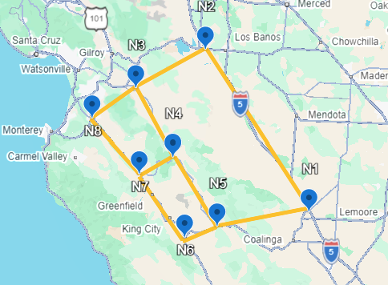

This is an illustration using the toy network `toy-ca`. The only user input required is `network.json`, which is explained in Section 1. The rest of the demo is automated.

The system behind it is drawn in [`schema/diagram.html`](../../schema/diagram.html). Open it in a browser, or run `python -m src diagram --open`. It has three tabs:

- **Model:** every function, with the tables it reads.
- **Functions:** how each function's outputs feed the next one's inputs, from hazard to fragility, usability, edge and system state.
- **Plates:** the tables of `network.json` and their keys.

Clicking a card shows its signature and parameter sets.

```{python}
#| label: setup
#| include: false
import json, os, sys
from pathlib import Path
from IPython.display import Markdown, display
from pprint import pprint
from textwrap import fill

ROOT = next(p for p in [Path.cwd(), *Path.cwd().parents] if (p / "pyproject.toml").is_file())
os.chdir(ROOT)
sys.path.insert(0, str(ROOT))

def show_table(frame):
    """Render small tables consistently in PDF."""
    header = "| " + " | ".join(map(str, frame.columns)) + " |"
    rule = "| " + " | ".join(["---"] * len(frame.columns)) + " |"
    rows = ["| " + " | ".join(str(v).replace("|", "\\|") for v in row) + " |"
            for row in frame.itertuples(index=False, name=None)]
    display(Markdown("\n".join([header, rule, *rows])))
```

## 1. The network dataset

The network is one file, `examples/toy-ca/network.json`, with one table per entity type.

```{python}
data = json.loads(Path("examples/toy-ca/network.json").read_text(encoding="utf-8"))
{table: len(rows) for table, rows in data["tables"].items()}
```

One row of each table:

```{python}
for table in ("Node", "Edge", "Bridge", "Event", "SystemEvent"):
    pprint({table: data["tables"][table][0]}, width=85, sort_dicts=False)
```

The tables:

```{python}
import pandas as pd

nodes = pd.DataFrame(data["tables"]["Node"]).set_index("id")
edges = pd.DataFrame(data["tables"]["Edge"]).set_index("id")
bridges = pd.DataFrame(data["tables"]["Bridge"]).set_index("id")
nodes
```

```{python}
edges
```

```{python}
bridges
```

The schemas the file is checked against: its shape, from its `$schema`, and each table's columns, from `schema/entities.json`.

```{python}
from jsonschema import Draft202012Validator

shape = json.loads(Path("schema/meta/network.schema.json").read_text(encoding="utf-8"))
print("$schema:", data["$schema"])
print("shape errors:", list(Draft202012Validator(shape).iter_errors(data)))
```

```{python}
entities = {e["id"]: e for e in json.loads(Path("schema/entities.json").read_text(encoding="utf-8"))["entities"]}

columns = []
for table, records in data["tables"].items():
    attrs = entities[table]["attributes"]
    in_file = set().union(*(r.keys() for r in records)) - {"id"}
    for name, spec in attrs.items():
        columns.append({"table": table, "column": name,
                        "schema type": f"-> {spec['ref']}" if "ref" in spec else spec["type"],
                        "required": spec.get("required", True), "in file": name in in_file})
    for name in sorted(in_file - attrs.keys()):
        columns.append({"table": table, "column": name, "schema type": "NOT IN SCHEMA", "required": None, "in file": True})
columns = pd.DataFrame(columns)
columns
```

They match: every required column is in the file, and the file has no column the schema lacks.

```{python}
missing = columns[columns.required.eq(True) & ~columns["in file"]]
extra = columns[columns["schema type"] == "NOT IN SCHEMA"]
print("required but missing:", missing[["table", "column"]].values.tolist())
print("in file, not in schema:", extra[["table", "column"]].values.tolist())
```

Every assumed value is named in the file:

```{python}
for key, text in data["assumptions"].items():
    print(fill(f"- {key}: {text}", width=90, subsequent_indent="  "))
```

The map:

{width=60%}

```{python}
#| label: fig-network
#| fig-cap: "Nodes, edges, bridges by class, key destinations and the demo scenario."
import matplotlib.pyplot as plt
import numpy as np

fig, ax = plt.subplots(figsize=(6, 5))
for _, e in edges.iterrows():
    a, b = nodes.loc[e.source], nodes.loc[e.target]
    ax.plot([a.lon, b.lon], [a.lat, b.lat], color="0.7", zorder=1)
ax.scatter(nodes.lon, nodes.lat, s=40, color="k", zorder=2, label="node")
for cls, group in bridges.groupby("hazus_class"):
    ax.scatter(group.lon, group.lat, s=35, marker="s", zorder=3, label=f"bridge {cls}")
key = nodes[nodes.key_destination]
ax.scatter(key.lon, key.lat, s=160, facecolors="none", edgecolors="tab:green", linewidths=2, zorder=4,
           label="key destination")
event = data["tables"]["Event"][0]
ax.scatter(event["lon"], event["lat"], marker="*", s=300, color="orange", zorder=5, label=f"scenario M{event['mw']}")
for nid, n in nodes.iterrows():
    ax.annotate(nid, (n.lon, n.lat), xytext=(4, 4), textcoords="offset points")
ax.set_aspect(1 / np.cos(np.radians(nodes.lat.mean())))
ax.set_xlabel("longitude")
ax.set_ylabel("latitude")
ax.legend(loc="lower left", fontsize=8)
plt.show()
```

Loading the network checks every row against `schema/entities.json`:

```{python}
from src.builder.load import check_tables, load_library, load_network

lib = load_library()                      # schema/ and instances/
net = load_network("toy-ca", lib)
{entity: len(rows) for entity, rows in net.tables.items()}
```

A broken row is refused, with the reason:

```{python}
broken = json.loads(json.dumps(net.tables))
broken["Bridge"][0]["edge"] = "e99"
broken["Edge"][0].pop("avg_speed_kph")
_, problems = check_tables(broken, lib, "toy-ca (edited)")
problems
```

## 2. Build the tbnpy model

The builder resolves the assembly and saves the model and RSR rules under this example.

```{python}
#| output: false
from src.builder.bn_builder import (
    generate_tbn, define_tbn_variables, define_tbn_probabilities,
)

model_dir = generate_tbn(Path("examples/toy-ca/demo.assembly.json"))
```

Load the saved data into tbnpy's two dictionaries:

```{python}
model_data = json.loads((model_dir / "model.json").read_text(encoding="utf-8"))
varis = define_tbn_variables(model_data)
probs = define_tbn_probabilities(model_data, varis, directory=model_dir)
print(f"{len(varis)} variables; {len(probs)} probability objects")
```

`varis` holds scalar variables, grouped below. The scenario (the Event row) is fixed data read by the hazard object, so it is not a variable.

```{python}
#| echo: false
from collections import Counter

counts = Counter(name.split("::")[0] for name in varis)
show_table(pd.DataFrame([{
    "quantity": quantity, "count": count,
    "type": "discrete" if isinstance(next(v.values for k, v in varis.items()
                                          if k.split("::")[0] == quantity), list) else "continuous",
} for quantity, count in counts.items()]))
kind_counts = Counter("discrete" if isinstance(v.values, list) else "continuous"
                      for v in varis.values())
display(Markdown(f"Total: **{kind_counts['continuous']} continuous** and "
                 f"**{kind_counts['discrete']} discrete** variables."))
```

`probs` holds the probability objects, each with `childs`, `parents`, `sample()` and `log_prob()`. Each variable has its own object, keyed by the variable, except the ten intensities: the hazard field draws them together.

```{python}
by_function = {}
for k, p in probs.items():
    by_function.setdefault(p.spec["function"], []).append((k, p))

def span(values):
    return str(min(values)) if min(values) == max(values) else f"{min(values)}–{max(values)}"

show_table(pd.DataFrame([
    {"function": f, "objects": len(ps),
     "children each": span([len(p.childs) for _, p in ps]),
     "parents each": span([len(p.parents) for _, p in ps]),
     "example key": ps[0][0]}
    for f, ps in by_function.items()
]))
```

The graph groups variables by quantity. Arrows show the conditional direction; each system state takes every edge state as input.

```{python}
#| label: fig-bn-families
#| echo: false
#| fig-cap: "Variable families and their counts. The intensities share one joint object; every other variable has its own."
#| fig-width: 7
#| fig-height: 2.1
fig, ax = plt.subplots(figsize=(7, 2.1))
positions = [(1.6, 0.5), (3.2, 0.5), (4.8, 0.5), (6.4, 0.5), (8, 0.5)]
labels = ["SA(1.0) (10)", "DamageState (10)", "Usable (10)", "EdgeOpen (10)", "SystemState (6)"]
boxes = []
for pos, label in zip(positions, labels):
    boxes.append(ax.text(*pos, label, ha="center", va="center", fontsize=7,
                         bbox=dict(boxstyle="round,pad=0.5", facecolor="#edf3f7", edgecolor="0.5")))
ax.set(xlim=(0.7, 8.9), ylim=(-0.5, 1.5))
ax.axis("off")
plt.tight_layout()
fig.canvas.draw()
for i, j in [(0, 1), (1, 2), (2, 3), (3, 4)]:
    ax.annotate("", xy=positions[j], xytext=positions[i],
                arrowprops=dict(arrowstyle="->", color="0.35", shrinkA=3, shrinkB=3,
                                patchA=boxes[i].get_bbox_patch(), patchB=boxes[j].get_bbox_patch()))
plt.show()
```

### One instance of each type

In tbnpy, a probability object's `parents` are its inputs and `childs` are its outputs. The examples below follow bridge b4, edge e4 and origin n4.

```{python}
#| include: false
import torch
from tbnpy import inference

with torch.random.fork_rng(devices=[]):
    torch.manual_seed(20261022)
    trace = inference.sample(probs, list(probs), n_sample=3)
draws = {v.name: trace[k].Cs[:, j] for k, p in probs.items()
         for j, v in enumerate(p.childs)}

def example_parents(prob):
    return torch.stack([draws[v.name] for v in prob.parents], dim=1)

def sampled_value(name):
    return draws[name][0].item()

hazard = probs["hazard.gmm"]
fragility = probs["DamageState.HazusBridge::b4"]
bridge_index = next(i for i, v in enumerate(hazard.childs) if v.name == "SA(1.0)::b4")
motion = hazard.distribution(1)
mass = fragility.distribution(example_parents(fragility))[0, 0]
damage_states = fragility.spec["states"]["damage"]
```

**Intensity — `SA(1.0)::b4`.** No parents: the event's Mw, epicentre and depth are fixed data from `network.json`. Outputs: all ten bridge intensities jointly; b4's output feeds `DamageState.HazusBridge::b4`. The Campbell function calculates log-median $\mu$ and dispersion $\sigma$, then draws $I=\exp(\mu+\sigma Z)$ with $Z\sim N(0,1)$. This demo supplies only SA(1.0), with independent residuals between bridges.

```{python}
#| echo: false
display(Markdown(f"For b4: median = {motion.loc[0, bridge_index].exp().item():.3f} g; "
                 f"log-dispersion = {motion.scale[0, bridge_index].item():.3f}; "
                 f"sampled intensity = {sampled_value('SA(1.0)::b4'):.3f} g."))
```

**Damage — `DamageState.HazusBridge::b4`.** Parent: `SA(1.0)::b4`. Child: `DamageState.HazusBridge::b4`, which feeds `Usable::b4`. Lognormal exceedances are differenced into five state probabilities, then one uniform draw per bridge picks a state index. Indices 0–4 denote none through complete.

```{python}
#| echo: false
show_table(pd.DataFrame({"damage state": damage_states,
                         "P(state given sampled intensity)": [f"{p:.3f}" for p in mass.tolist()]}))
sampled_index = int(sampled_value("DamageState.HazusBridge::b4"))
meaning = " (no damage)" if damage_states[sampled_index] == "none" else ""
display(Markdown(f"Sampled damage at b4: index {sampled_index}, "
                 f"state **{damage_states[sampled_index]}**{meaning}."))
```

**Usability — `Usable::b4`.** Parent: `DamageState.HazusBridge::b4`. Child: `Usable::b4`, which feeds `EdgeOpen::e4`. The closure policy deterministically maps none/slight/moderate to 1, and extensive/complete to 0.

**Edge state — `EdgeOpen::e4`.** Parents: the usability of every bridge on e4, here `Usable::b4`. Child: `EdgeOpen::e4`. An edge is open only if every bridge on it is usable. Every edge state feeds each origin's system state, n3–n8.

For example, this calls the edge object's sampling method directly. The tensor columns follow `parents`; returned columns follow `childs`.

```{python}
edge = probs["EdgeOpen::e4"]
Cs_pars = example_parents(edge)
Cs_child, logp = edge.sample(Cs_pars=Cs_pars)
print("parents:", [v.name for v in edge.parents], "; childs:", [v.name for v in edge.childs])
print("b4 usability:", int(sampled_value("Usable::b4")))
print("e4 state:", int(Cs_child[0, 0]), "; probability:", float(np.exp(logp[0])))
```

**System state — `SystemState::n4`.** Parents: all ten edge states. Child: `SystemState::n4`, with no downstream variables; each of the six origins has its own object. RSR first classifies the edge configuration; ndtools handles any unknowns. Survival means n4 reaches n1 or n2 within 0.5 hours of its intact travel time, with edge time = length/speed.

```{python}
#| echo: false
display(Markdown(f"Sampled state of n4: **{int(sampled_value('SystemState::n4'))}**."))
```

## 3. The RSR results

Each origin has survival and failure rules under `rsr/<origin>/target_add_h=0.5/`, the network's threshold. The counts below also check rule coverage across all 1,024 edge configurations.

```{python}
#| echo: false
import itertools
import torch
from rsr.rsr import classify_samples_with_indices

state_keys = [k for k, p in probs.items() if p.spec["role"] == "system"]
coverage = []
for key in state_keys:
    system, row = probs[key], probs[key].spec["rows"][0]
    configurations = torch.tensor(list(itertools.product((0, 1), repeat=len(system.parents))))
    one_hot = torch.nn.functional.one_hot(configurations, 2).to(torch.int32)
    upper, lower = system.refs[0]
    classified = classify_samples_with_indices(one_hot, upper, lower)
    metrics = [json.loads(line) for line in
               (model_dir / "rsr" / row["id"] / "target_add_h=0.5" / "metrics.json").read_text().splitlines()]
    coverage.append({"origin": row["id"], "survival rules": len(upper),
                     "failure rules": len(lower), "rounds": len(metrics),
                     "unclassified / 1024": classified["unknown"]})
show_table(pd.DataFrame(coverage))
```

For example, these rules determine whether n4 stays within 0.5 hours of its intact travel time. `1` means open; `0` means closed. Unlisted edges are unrestricted.

```{python}
for filename, outcome in (("refs_up_1.json", "survives"),
                          ("refs_low_0.json", "fails")):
    rules = json.loads((model_dir / "rsr/n4/target_add_h=0.5" / filename).read_text())
    for rule in rules:
        conditions = " and ".join(f"{edge}={value}" for edge, (_, value) in rule.items()
                                  if edge != "sys")
        print(f"{conditions} -> n4 {outcome}")
```

RSR classifies the BN's edge samples; ndtools resolves any unclassified configurations. The 50/50 edge probabilities used during rule search are not the BN's probabilities.

## 4. Sample the BN

tbnpy samples the system state and all its ancestors using PyTorch. These are Monte Carlo estimates under the demo scenario.

```{python}
from tbnpy import inference

torch.manual_seed(20261022)
result = inference.sample(probs, state_keys, n_sample=5000)
show_table(pd.DataFrame([
    {"origin": key.split("::")[1],
     "P(fails)": f"{(result[key].Cs[:, 0] == 0).double().mean().item():.4f}"}
    for key in state_keys
]))
```

### Sampling time

CPU timings for the same six system states and their ancestors, using one CPU thread and batches of 50,000. Each time is the median of three runs after a warm-up; model building and RSR extraction are excluded. P(fails) for n7 and n8 is from the first run at each size.

```{python}
#| label: sampling-timing
#| echo: false
#| output: false
from time import perf_counter
from statistics import median

torch.set_num_threads(1)
batch_size = 50_000
inference.sample(probs, state_keys, n_sample=batch_size)  # warm-up
watched = ["SystemState::n7", "SystemState::n8"]
measurements = []
for n in range(100_000, 1_000_001, 100_000):
    seconds = []
    for repeat in range(3):
        torch.manual_seed(20261022 + repeat)
        start = perf_counter()
        sampled = inference.sample(probs, state_keys, n_sample=n, batch_size=batch_size)
        seconds.append(perf_counter() - start)
        if repeat == 0:          # estimated after the clock stops, from the first run
            p_fail = {k.split("::")[1]: (sampled[k].Cs[:, 0] == 0).double().mean().item() for k in watched}
        del sampled
    measurements.append({"samples": n, "seconds": seconds, "median_s": median(seconds), "P_fail": p_fail})
```

```{python}
#| echo: false
import platform
from datetime import datetime, timezone

benchmark = {
    "measured_at_utc": datetime.now(timezone.utc).isoformat(),
    "assembly": model_data["assembly"]["id"],
    "source_sha256": model_data["source_sha256"],
    "query_nodes": state_keys, "origins": [k.split("::")[1] for k in state_keys],
    "device": str(system.device), "processor": platform.processor(),
    "torch_version": torch.__version__, "torch_threads": torch.get_num_threads(),
    "dtype": "float64", "batch_size": batch_size, "repetitions": 3,
    "warmup_samples": batch_size, "seed_base": 20261022,
    "includes": "sampling all ancestors and accumulating system-state results",
    "excludes": "model building, rule extraction, seed setting and reporting",
    "measurements": measurements,
}
(model_dir / "sampling_benchmark.json").write_text(
    json.dumps(benchmark, indent=2) + "\n", encoding="utf-8")
display(Markdown(f"PyTorch {torch.__version__}; {torch.get_num_threads()} CPU threads; float64."))
show_table(pd.DataFrame([
    {"samples": f"{r['samples']:,}", "median time (s)": f"{r['median_s']:.3f}",
     "samples/s": f"{r['samples'] / r['median_s']:,.0f}",
     **{f"P({origin} fails)": f"{p:.4f}" for origin, p in r["P_fail"].items()}}
    for r in measurements
]))
```

The individual timings and settings are saved in `tbnpy/demo/sampling_benchmark.json`.

## 5. The app

Run `python -m src serve --example toy-ca/demo --open`. The Map tab combines
scenario controls, the network, results and Ask; BN and Schema show the model.
Ask translates words into validated queries, reads them back, then gives the
engine's results and provenance. Optional query review pauses before sampling.

The engine supports forced discrete node states, joint events and discrete
observations. Comparisons, bridge importance and candidate-path rankings are
computed in Python. Inspection priority uses value of information from supplied
actions, losses, accuracy and cost. Missing inputs prompt a clarification.
Evidence with too few matching samples is refused; continuous evidence and
sequential inspection policies remain outside this pilot.

The Proposals tab reviews new parameter sets and saved scenario variants.
Drafts include sources and validation results; a named user activates the
reviewed version. New mathematical forms still need code and tests.

## 6. Hazard: the mock now, and what is expected

The hazard node generates **a joint sample of the intensity measure at every bridge.** There are two modes that differ in what supplies it.

| Mode | Source | Status |
|---|---|---|
| Preparation | OpenQuake scenario: rupture + GMM | **to build**; a mock stands in |
| Emergency | ShakeCast-triggered USGS ShakeMap | built; needs connecting to live ShakeCast |

### The contract

A hazard function is one probability object over all bridges. The current mock looks like:

```{python}
hazard = probs["hazard.gmm"]
Cs, logp = hazard.sample(n_sample=4)
print("childs:", [v.name for v in hazard.childs[:3]], "...", len(hazard.childs))
print("parents:", hazard.parents)
print("sample ->", tuple(Cs.shape), "IMs in g;", tuple(logp.shape), "log probabilities")
print("notes:", fill(hazard.notes[0], 90))
```

| Item | Requirement |
|---|---|
| `childs` | `<IMT>::<bridge id>` for every bridge, e.g. `SA(1.0)::b4` |
| `sample(n_sample=n)` | `(n, bridges)` tensor of IMs (g, or cm/s for PGV), plus `(n,)` log probabilities |
| `log_prob(Cs)` | log density of given samples, consistent with `sample` |
| `imt` | the same IM as the fragility curves (`SA(1.0)` for Hazus); `check` refuses a mismatch |
| `notes` | provenance shown with every answer: model, map version, assumptions |
| fixed data | the `Event` row and each bridge's `lat`/`lon` (and `vs30` when the GMM needs it) |

### The mock (stands in for preparation mode)

The scenario is the `Event` row of `network.json`. The GMM is a parameter set chosen by location. The demo set reuses Campbell (2003)'s eastern North America coefficients over a box drawn around toy-ca. Its residuals are independent between bridges.

```{python}
demo_gmm = lib.parameter_sets["demo.campbell-2003-in-california"]
print("Event:", {k: v for k, v in data["tables"]["Event"][0].items() if k != "description"})
print("set:", demo_gmm["label"])
print({k: demo_gmm["values"][k] for k in ("form", "imt", "sigma_epistemic", "magnitude_range")})
print("region:", demo_gmm["region"]["name"], "[lon, lat] box:", demo_gmm["region"]["polygon"][0], "to", demo_gmm["region"]["polygon"][2])
```

### Preparation mode: OpenQuake (expected)

**Where it goes.** A new function, say `hazard.openquake-scenario`. Its class lives in `src/builder/kernels/hazard.py`, and it is the same kind of object as `Gmm`: per `Bridge`, `drawKind: Joint`, output `{imt}`, reading the `Event` table and each bridge's `lat`, `lon` and `vs30`.

**What OpenQuake supplies.** `openquake.hazardlib` gives each site's mean ln IM and the between-event ($\tau$) and within-event ($\phi$) standard deviations, for the rupture and the GMM.

**What we sample.** We sample the field ourselves; it is fast enough for $10^6$ draws. $\eta$ is one draw shared by every bridge. $\varepsilon$ is correlated between bridges by the existing `hazard.spatial-correlation` model (Jayaram & Baker 2009).

$$\ln I_b = \mu_b + \tau_b\,\eta + \phi_b\,\varepsilon_b$$

**Instances.** A parameter set under `instances/hazard/` names the GMM and its IM, e.g. `{"gsim": "...", "imt": "SA(1.0)"}`, with a `region` so `parameter_set_by_location` can choose it.

**Data.**

- `Event` gains what an OpenQuake rupture needs, e.g. strike, dip, rake, or a path to a `rupture.xml`.
- `Bridge.vs30` takes the user's value where given. Missing values are filled with `python -m src vs30 <network>` from the USGS mosaic. That command is untested: it needs GDAL and the grid downloaded by hand.

**Several IMs** (e.g. PGA and SA(1.0)) stay in the same object, so their correlation is kept.

Swapping the mock for it is one binding in the assembly; nothing else changes:

```json
{"function": "hazard.gmm", "parameter_set_by_location": ["demo.campbell-2003-in-california"]}
{"function": "hazard.openquake-scenario", "parameter_set_by_location": ["<oq set for California>"]}
```

The rules extracted in section 3 still apply after the swap, because they depend on the network and the system event, not the hazard. The same holds for a changed scenario:

```{python}
from src.builder.bn_builder import build_tbn
from src.inference.engine import compile_query

_, other = build_tbn(compile_query({"assembly": "toy-ca/demo",
                                    "rows": {"demo-san-andreas": {"mw": 7.0}}}))
print("rules reused at M7.0:", all(p.refs[0] is not None
                                   for p in other.values() if p.spec["role"] == "system"))
```

### Emergency mode: ShakeCast to ShakeMap (in place)

Two functions already do this, as in `hebei-transport/shakemap`:

- `hazard.spatial-correlation` draws the residual field $\varepsilon$ jointly over all bridges.
- `hazard.shakemap` reads the median from `grid.xml` and $\sigma$ from `uncertainty.xml` at each bridge, and sets $\ln I = \ln\mathrm{median} + \sigma\varepsilon$.

```{python}
hebei = json.loads(Path("examples/hebei-transport/shakemap.assembly.json").read_text(encoding="utf-8"))
for b in hebei["bindings"][:2]:
    pprint({k: v for k, v in b.items() if k != "note"}, width=90)
```

**Where maps come from.**

- **ShakeCast first:** its data directory (`SHAKECAST_USER_DIRECTORY`, default `~/.shakecast`), laid out as `<event>/<event>-<version>/grid.xml`.
- **USGS catalogue otherwise.**
- **Choosing:** `BN_SHAKEMAP_SOURCE` = `auto`, `shakecast` or `comcat`.
- **Caching:** grids are cached in `.cache/shakemaps/`.
- **Outside the map:** a bridge outside the map is refused, not set to zero.

**What is expected.**

- **ShakeCast's trigger:** it should hand the new `event_id` to the assembly, e.g. `--set` or the query's `parameters`: `{"hazard.shakemap": {"event_id": "..."}}`.
- **The live server:** the directory layout and the grid fields (`PSA10`/`STDPSA10` for SA(1.0), and so on) should be confirmed against a live ShakeCast server.
- **A toy-ca assembly for this mode:** `toy-ca/shakemap` would use a California scenario ShakeMap, so both modes can be compared on the same network.

### Checks a new hazard must pass

- `python -m src check`: its schema file and instances validate, and its IM wires to the curves.
- `sample` and `log_prob` agree, as `test_samples_and_log_probabilities_agree` checks for the current objects.
- A closed-form check on one bridge, like `test_event_probability_matches_the_closed_form` for the GMM.

### Other potential useful additions

- Showing the rupture locations or other hazard information in the map, overlaid with the network.


## 7. LLM-related files and expanding the test cases

The answer files below live in `examples/toy-ca/`; code paths start at the repository root.

| Files | Role |
|---|---|
| `answer-sheet.md`, `answer-cases/*.json` | Agreed meanings and executable expectations: context, phrasings, tools and forbidden interpretations. |
| `src/llm/chat.py`, `cases.py` | Translation, tools, few-shot selection and held-out evaluation. |
| `src/inference/engine.py`, `query.schema.json` | Sampling, interventions, joint events and evidence. |
| `comparisons.py`, `decision.py`, `records.py` in `src/inference/` | Comparisons and paths, VOI, and provenance. New numerical capabilities need tests. |
| `schema/`, `instances/`, network and assembly JSON | Allowed structures, sourced values and their application. New forms need kernels and tests. |
| `src/proposals.py`, `proposals/` | Draft validation and reviewed activation. |
| `src/app/server.py`, `quakenet.html` | API and interface for new tools and results. |

Copy a case JSON, give it a new ID, and vary networks, origins, destinations,
thresholds, evidence, interventions and wording. Include missing-input questions;
distinguish inspection from repair and observation from intervention. Keep
held-out cases out of prompts.

`python -m src evaluate` checks contracts; `--live` logs held-out LLM translations
without computing. Review semantic alternatives; contract checks alone are not
LLM accuracy.
