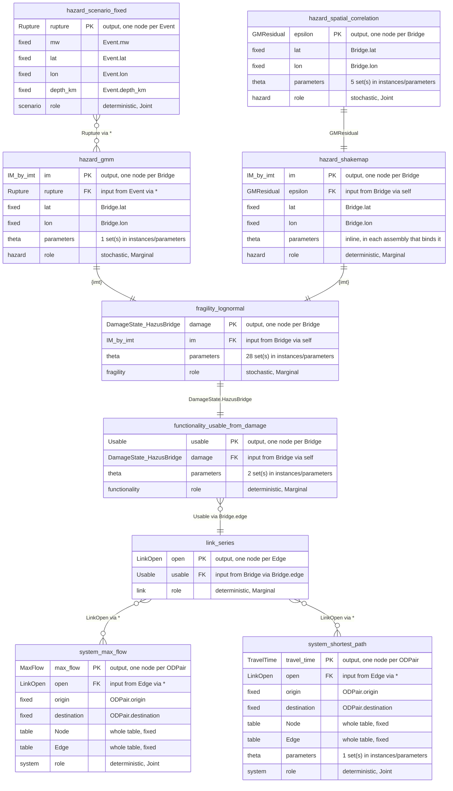
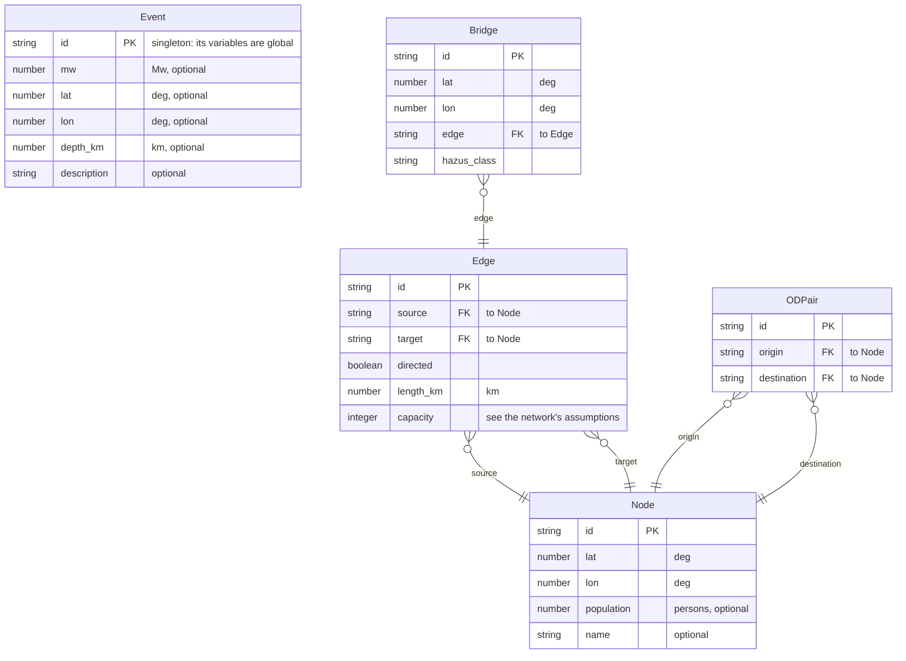

# Schema diagram

<!-- Generated by `python -m src diagram` from schema/*.json; edit those, not this. The tests fail if it is stale. -->

9 functions, 5 plates and 12 quantities. GitHub draws the diagrams below; in VS Code the Markdown preview needs a Mermaid extension. [`diagram.html`](diagram.html), beside this file, draws the same schema interactively: open it in a browser.

## Functions: what can connect to what

Each function is a table. Its output (PK) is the BN node it defines, one per row of its plate; its inputs (FK) are the nodes it reads. A link joins an output to every input of the same quantity on the same plate; where several hazard functions feed one input, they are alternatives, and an assembly binds one.

Link ends, producer left, consumer right: `||--||` one parent, the same row · `||--o{` many nodes share one parent · `}o--||` many parents per node · `}o--o{` every node of the plate is a parent.

## Plates: the tables functions are replicated over

Attributes are fixed data, never BN nodes. Foreign keys are what an input's `via` follows.

## Quantities: the types on the links

| Quantity | Kind | Unit or states | Meaning | Used by |
|---|---|---|---|---|
| `Rupture` | record | record of mw, lat, lon, depth_km | Earthquake rupture (point source) | `hazard.gmm (in)`, `hazard.scenario-fixed (out)` |
| `PGA` | continuous | g | Peak ground acceleration | `fragility.lognormal (in)`, `hazard.gmm (out)`, `hazard.shakemap (out)` |
| `PGV` | continuous | cm/s | Peak ground velocity | `fragility.lognormal (in)`, `hazard.gmm (out)`, `hazard.shakemap (out)` |
| `SA(0.3)` | continuous | g | Spectral acceleration, T = 0.3 s, 5% damping | `fragility.lognormal (in)`, `hazard.gmm (out)`, `hazard.shakemap (out)` |
| `SA(1.0)` | continuous | g | Spectral acceleration, T = 1.0 s, 5% damping | `fragility.lognormal (in)`, `hazard.gmm (out)`, `hazard.shakemap (out)` |
| `SA(3.0)` | continuous | g | Spectral acceleration, T = 3.0 s, 5% damping | `fragility.lognormal (in)`, `hazard.gmm (out)`, `hazard.shakemap (out)` |
| `GMResidual` | continuous | standard deviations | Normalised ground-motion residual at one bridge | `hazard.shakemap (in)`, `hazard.spatial-correlation (out)` |
| `DamageState.HazusBridge` | discrete | none, slight, moderate, extensive, complete | Hazus highway-bridge damage state | `fragility.lognormal (out)`, `functionality.usable-from-damage (in)` |
| `Usable` | discrete | {0,1} | Component usable after the event | `functionality.usable-from-damage (out)`, `link.series (in)` |
| `LinkOpen` | discrete | {0,1} | Network link open to traffic | `link.series (out)`, `system.max-flow (in)`, `system.shortest-path (in)` |
| `TravelTime` | continuous | min | Shortest travel time, origin to destination | `system.shortest-path (out)` |
| `MaxFlow` | continuous | Edge.capacity units | Maximum flow, origin to destination | `system.max-flow (out)` |
